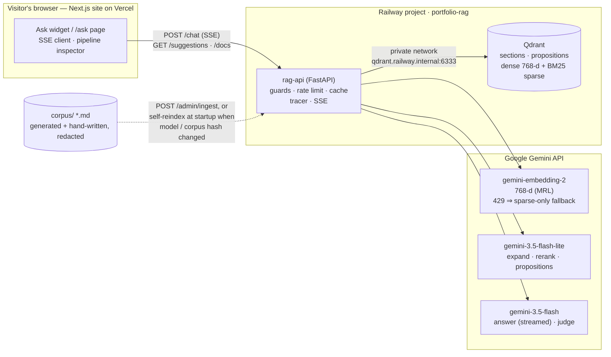
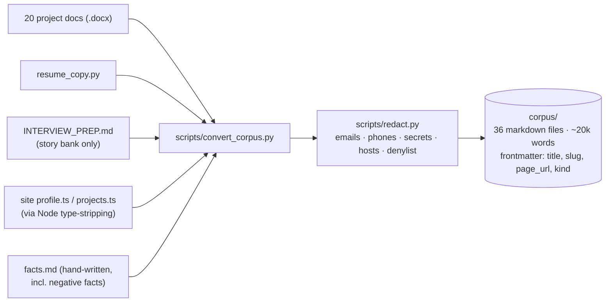
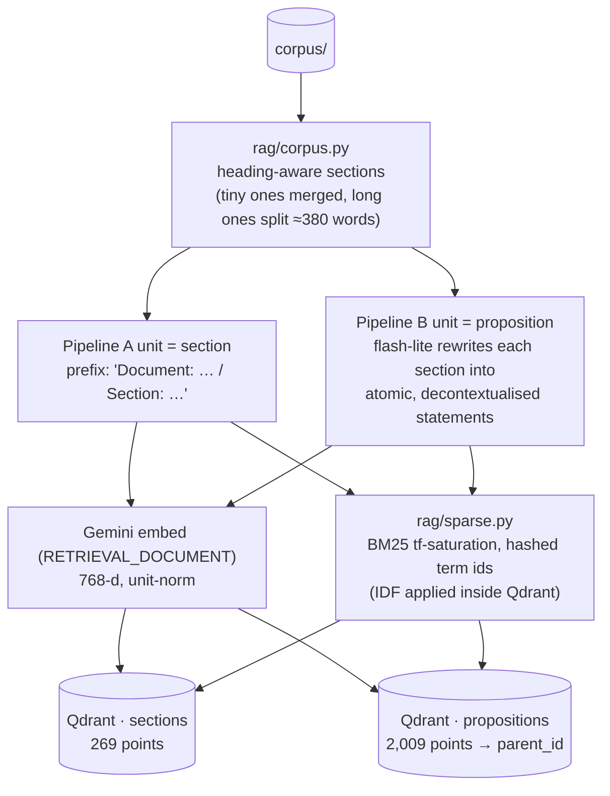
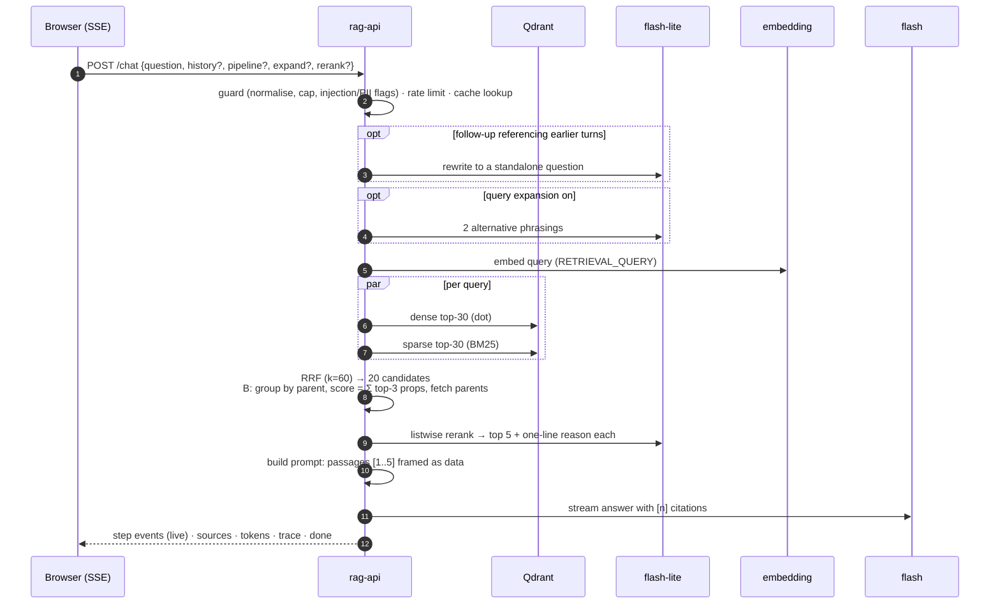
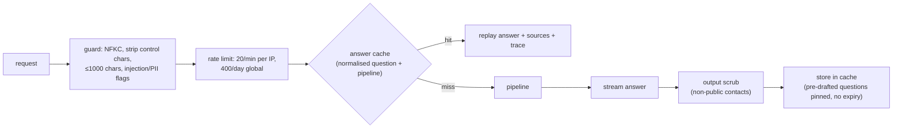
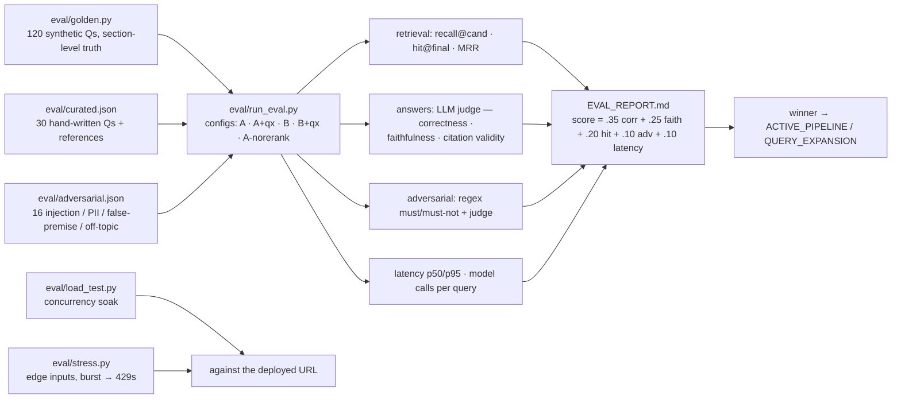

# Ask-about-Aditya — architecture

A retrieval-augmented assistant over Aditya Mukhopadhyay's project documents, served as a glass-box chatbot on
[adityamukhopadhyay.vercel.app/ask](https://adityamukhopadhyay.vercel.app/ask). Every answer cites its sources, and every
query exposes the full pipeline run — expanded queries, dense and sparse top-K, fusion, the reranker's reordering with its
reasons, the prompt, and every model call with its latency.

Nothing runs on a laptop in production: the API and the vector database run on Railway; embeddings, reranking and
generation are Gemini API calls.

## 1. System overview



## 2. Corpus pipeline (build time)



Structure is preserved (headings → `#`, lists, tables, embedded screenshots → `media/`), because both chunkers split on it.
Each document carries its portfolio page URL so citations can link to the human-readable page rather than the raw file.

## 3. Indexing — the A/B variable



| | A — sections | B — propositions → parent |
|---|---|---|
| what is embedded | the section text with a deterministic situating prefix | one atomic statement (subject always named) |
| what the answerer reads | the section | the **parent section** of the matched propositions (small-to-big) |
| cost at ingest | 269 embeddings | 269 flash-lite extractions + 2,009 embeddings |
| intuition | robust, cheap, keeps context together | precise matching on facts, immune to pronoun/context loss |

## 4. Query pipeline (per request)



Every stage records its duration and its inputs/outputs on a `Tracer` (`rag/trace.py`). The API streams each step to the
client the moment it finishes, then the sources, then the answer tokens, then the complete trace. The UI renders this as a
timeline plus expandable step cards; the reranker card shows every passage's in→out position and the model's stated reason.

## 5. Serving, guards and cost control



- **Prompt-injection hardening**: passages are labelled as data; the system prompt instructs the model to ignore embedded
  instructions. The adversarial set exercises this.
- **Negative knowledge** lives in `corpus/profile/facts.md` (what he does *not* use, what is *not* on record) and is
  restated in the system prompt, so "does he use LangChain" is answered from a fact, not from absence of evidence.
- **Thinking off** (`thinking_level=minimal`): Gemini 3.x thinks by default and the thoughts count against
  `max_output_tokens`; with defaults a 700-token budget produced 26 answer tokens.
- **Pre-drafted questions** (`rag/suggestions.py`) are answered once at startup and pinned in the cache with their trace.

## 5a. Persona — the assistant speaks as Aditya

The assistant answers in the first person as an AI version of Aditya. Three pieces make that work without hurting retrieval:

- **System prompt**: "you" in a visitor's question means Aditya; answer as "I"; the chatbot itself is one of Aditya's
  projects; if asked whether it is really him, say it is an AI version answering from his documents.
- **Persona rewrite (retrieval only)**: the corpus talks about "Aditya", visitors say "you". A deterministic, traced step
  rewrites second person to third for the search query — "Do you know MCP?" → "does Aditya know MCP?" — while the answerer
  still sees the visitor's original wording. The inspector shows the rewrite as its own row.
- **Pre-drafted questions in the second person** ("Have you worked on…", "How did you build…"), pinned in the cache.

## 5b. Per-visitor quota

Production allows **5 live questions per visitor per 24 h** (`RATE_LIMIT_PER_USER=5`), keyed on a client-generated id sent
as `X-Client-Id` (IP fallback). Only questions that actually reach the models count; cached and pre-drafted answers are free
and unlimited. The composer shows the remaining count and disables itself at zero; the suggested questions keep working.
Locally the limit is 0 (unlimited). Per-IP-per-minute and global-per-day limits sit underneath.

## 5c. "Let's connect" — booking a call

A CTA in the greeting and a calendar glyph in the header open a booking form: 14 day chips (plus a native date picker),
time slots shown in the visitor's own time zone (offered hours are 10:00–20:00 IST, converted client-side), name, email
and an optional note. `POST /book` validates, converts to IST, appends a JSONL record, emails Aditya (FormSubmit by
default — no account, one-time activation; Web3Forms / Resend / SMTP are drop-in alternatives via `BOOKING_PROVIDER`),
and returns an "Add to Google Calendar" link. Bookings are limited to 3 per visitor per day and 1 per minute; links in the
note are rejected. The assistant's system prompt ends hiring/contact answers with an invitation to book.

## 5d. Deploys are overlapped (zero downtime)

Railway's default single-instance deploy stops the old container before the new one is ready — a ~30 s window in which
the site shows "Network error". One such window was hit by a real visitor on 2026-09-17 at 21:28 IST while a volume was
being attached. The service now sets `overlapSeconds: 60` with `healthcheckPath: /health`, so a new container must pass
its health check and serve alongside the old one before the old one is removed.

## 5e. Question log (rolling 7 days)

Every question is appended to `/data/questions.jsonl` on a Railway volume (the container filesystem is wiped on each
deploy): timestamp in IST, the question, pipeline, whether it was answered from cache, latency, a 240-character answer
preview, the source document slugs, and a 10-character hash of the visitor id — never the raw id or IP. Rows older than
7 days are pruned on write (hourly at most). `GET /admin/questions` returns the rows plus a summary (per-day counts,
top questions, unique visitors); `scripts/questions.py` prints it from the terminal.

## 5f. Who asked, and the private console

Visitors may optionally say who they are — name, email **or** phone, company — from a person glyph in the chat header, or
from a one-time card that appears after two answers and can be dismissed for good. Nothing is required or verified;
`POST /identify` stores it against the same hashed visitor id the question log uses and **backfills** the questions that
visitor already asked, so a late introduction is not lost.

`/personal` on the portfolio carries a live console for this: headline counts, a per-day bar, and three tabs — every
question (expandable to the answer preview, pipeline, sources and contact), the people who identified themselves, and the
calls booked. It reads the API with a **read-only `DASHBOARD_TOKEN`** kept in the browser's localStorage: nothing secret
is in the deployed bundle, and that token is rejected (401) on `/admin/ingest` and every other write.

## 6. Evaluation harness



Results: see **[eval/EVAL_REPORT.md](../eval/EVAL_REPORT.md)** (A/B) and §8 below (stress + load).

## 7. Repository layout

```
corpus/          generated markdown — the only thing the index is built from
scripts/         convert_corpus.py · redact.py (+ redact_terms.txt) · railway_provision.py
rag/             config · corpus · chunking · sparse · gemini · store · pipelines · rerank · answer · guards · cache · trace · suggestions · ingest
api/             main.py (FastAPI, SSE) · ratelimit.py
eval/            curated.json · adversarial.json · golden.py · run_eval.py · merge.py · load_test.py · stress.py · EVAL_REPORT.md
tests/           unit tests (no network)
docs/            this document
site (separate repo: portfolio)  src/components/AskWidget.tsx · PipelinePanel.tsx · src/app/ask/page.tsx
```

## 8. Results

### 8.1 A/B evaluation (2026-09-17)

30 curated + 60 synthetic + 16 adversarial questions, five configurations, each run in its own process on an identical
copy of the index. Answers judged by `gemini-3.5-flash` against references and the retrieved passages.

| config | score | correctness | faithfulness | citations | hit@final | recall@cand | MRR | adversarial | p50 | p95 | calls/q |
|---|---|---|---|---|---|---|---|---|---|---|---|
| **A · no rerank** | **0.987** | 0.987 | 1.000 | 0.992 | 0.989 | 1.000 | 0.866 | 0.938 | 2.29 s | 3.15 s | 2 |
| A | 0.932 | 0.982 | 1.000 | 0.992 | 0.989 | 1.000 | 0.869 | 0.938 | 3.59 s | 4.57 s | 3 |
| B | 0.931 | 0.987 | 0.992 | 0.988 | 0.989 | 0.989 | 0.862 | 0.938 | 3.62 s | 4.33 s | 3 |
| A + expansion | 0.892 | 1.000 | 1.000 | 0.992 | 0.989 | 1.000 | 0.858 | 0.938 | 4.72 s | 5.86 s | 4 |
| B + expansion | 0.889 | 0.993 | 0.998 | 1.000 | 0.989 | 1.000 | 0.872 | 0.938 | 4.72 s | 5.76 s | 4 |

What the numbers say:

- **Retrieval is not the bottleneck on this corpus.** Every config puts the ground-truth section in the five passages handed
  to the answerer 98.9% of the time, and in the candidate set ≥98.9%. With 269 sections and questions that name concrete
  mechanisms, hybrid dense + BM25 with RRF is already sufficient.
- **The reranker did not earn its latency.** `hit@final` and MRR are unchanged with it on or off; it costs ~1.1 s and one
  extra model call per question. It stays available as a toggle (and is fully traced in the inspector) but is off by default.
- **Query expansion did not help either** — +1.1 s for the same hit rate. Same treatment: available, off by default.
- **Propositions (B) match sections (A) but do not beat them.** B's precision advantage does not show on a corpus whose
  sections are already short and self-contained; it costs 269 extraction calls at ingest for no gain. A is the default.
- **Faithfulness ≈ 1.0 across the board**: the answer prompt's "passages are data, cite or decline" rule holds.
- **Adversarial 15/16 on every config**: the one consistent miss is the "🤖🤖🤖???" input, where the model answers
  cheerfully instead of asking for a clearer question — a prompt tweak, not a retrieval issue.

The evaluation's winner is recorded in `eval/WINNER.json` (A, no expansion, no rerank). **The deployed defaults are a
product decision, recorded separately in `eval/DEPLOY_DEFAULTS.json`: pipeline A (the winner), query expansion OFF,
reranker ON.** Expansion was switched off because it bought no accuracy on this corpus, cost ~1 s, and turned one
question into three searches in the inspector; the reranker stays on so candidates are ordered by the model and the
rerank stage — with its per-passage reasons — is always visible. Both remain switchable per request.

### 8.2 Stress and load tests — live (2026-09-17, rag-api-production-5a59.up.railway.app)

**Edge-input stress (`eval/stress.py`): 18 / 18 passed.** Empty and whitespace → 400; 4,001 chars → 422 (schema);
1,001 chars → 413 (guard); control characters, JSON quotes/backslashes, emoji + Devanagari + CJK, HTML, SQL and
prompt-injection payloads → 200 with a normal answer and no `<script>` echoed back; bad pipeline value falls back to the
default; malformed history / missing field / non-JSON → 422. An anonymous burst of 30 requests produced `200 × 3, 429 × 27`
— the per-minute IP limiter engaged, never a 5xx.

**Concurrency load (`eval/load_test.py`): 20 concurrent, 120 requests, half SSE, admin bearer (bypasses limits so the
pipeline itself is measured): 120 / 120 → 200, 0 errors, 8.1 requests/s sustained on the single Railway instance.**

| metric | value |
|---|---|
| latency p50 / p90 / p95 / max | 1.96 s / 2.54 s / 2.81 s / 6.0 s |
| SSE first token p50 / p95 | 1.40 s / 2.23 s |
| cache hits (repeated questions) | 10 / 120 |
| rate-limited | 0 (admin) — the same run without the bearer is 100 % 429, which is the intended behaviour for a scraper |

Under 20-way concurrency the per-request latency stayed within ~15 % of the single-request benchmark (2.3 s p50),
i.e. the process is I/O-bound on Gemini and Qdrant, not CPU-bound; the answer cache and the per-visitor quota, not the
instance, are what bound cost.

**End-to-end on the live site:** a cached suggestion answered in 2.1 s with the full trace replayed; a live question ran the
persona rewrite → embed → dense → sparse → RRF → prompt → generate path with the inspector updating step by step; a call was
booked through the modal (Mon 21 Sep 2026 · 11:00 IST) and the notification arrived in Aditya's inbox within seconds.
